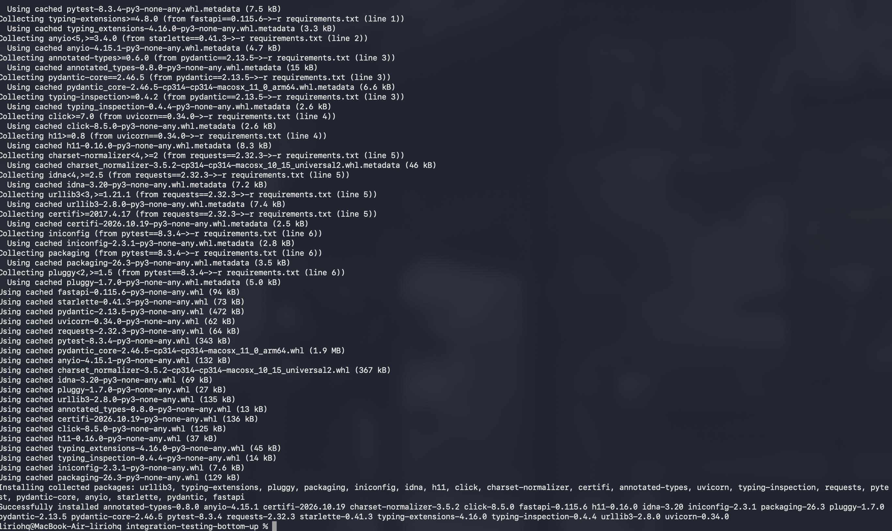
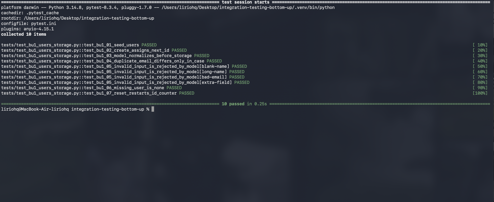
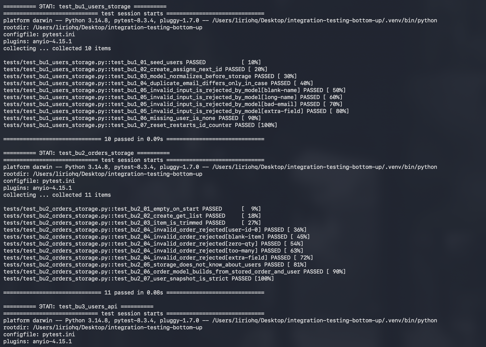
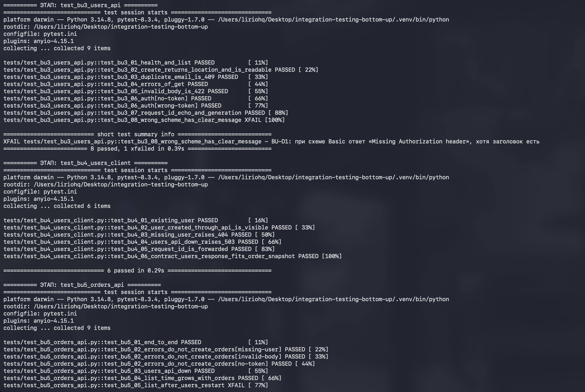
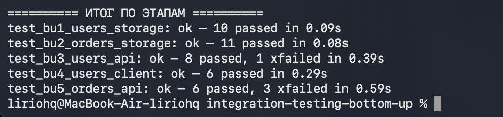
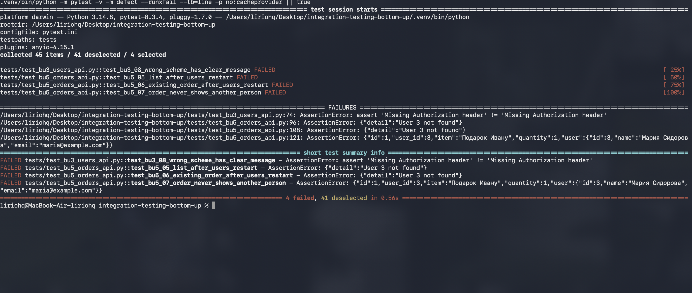

# Интеграционное тестирование методом «снизу вверх»

Лабораторная по курсу «Интеграционное тестирование».

По заданию метод применяется «снизу вверх»: сначала проверяются базовые модули, хранилища и модели, потом к ним по очереди подключаются модули выше — HTTP-клиент и контроллеры. На каждом этапе тесты запускаются отдельно, результаты и найденные ошибки записываются.

Отчёт: [`report/otchet-bottom-up.md`](report/otchet-bottom-up.md), тот же текст в Word — `report/Otchet-bottom-up.docx`.

## Проект

Учебный проект с прошлых работ: два сервиса на FastAPI, данные хранятся в памяти.

| Сервис | Что делает |
|---|---|
| Users API | Пользователи. При запуске уже есть Анна (id=1) и Пётр (id=2) |
| Orders API | Заказы. При создании и чтении заказа запрашивает пользователя в Users API |

```
клиент ──► Orders API ──GET /api/v1/users/{id}──► Users API
```

Код сервисов лежит в `users_service/` и `orders_service/`.

Модули разложены по уровням. Нижний уровень ни от кого не зависит, верхний вызывает всех остальных.

```
уровень 4   контроллер Orders API
уровень 3   HTTP-клиент Orders API ──► Users API
уровень 2   Users API: контроллер и проверка токена
уровень 1   модели и хранилища обоих сервисов
```

Заглушек нет, на каждом этапе работают настоящие модули. Вместо ещё не подключённого модуля сверху стоит драйвер: на нижних уровнях тест сам вызывает методы хранилища, выше — отправляет HTTP-запросы.

## Этапы

| Этап | Уровень | Файл | Что проверяется |
|---|---|---|---|
| 1 | 1 | `test_bu1_users_storage.py` | модели и хранилище пользователей |
| 2 | 1 | `test_bu2_orders_storage.py` | модели и хранилище заказов |
| 3 | 2 | `test_bu3_users_api.py` | Users API целиком |
| 4 | 3 | `test_bu4_users_client.py` | HTTP-клиент Orders API и настоящий Users API |
| 5 | 4 | `test_bu5_orders_api.py` | контроллер Orders API, это уже вся система |

## Запуск

Нужен Python 3.12 или новее. Команды выполняются из папки репозитория.

```bash
cd integration-testing-bottom-up
make install
make test
```

`make install` создаёт `.venv` и ставит зависимости.



Сервисы отдельно запускать не нужно: тесты поднимают их сами.

Первый этап, модели и хранилище пользователей:

```bash
.venv/bin/python -m pytest tests/test_bu1_users_storage.py -v
```



`make test` идёт строго снизу вверх. Если нижний этап не прошёл, верхние не запускаются. Вывод каждого этапа сохраняется в `results/`.







`xfailed` здесь не сбой запуска. Так помечены тесты на уже найденные дефекты: пока дефект в коде есть, тест падает, и это ожидаемо. Посмотреть их как обычные падения:

```bash
make defects
```



`4 failed` — по одному тесту на каждый дефект.

## Что вышло на этапах

Этапы 1 и 2 проходят целиком. На первом этапе видно, что после сброса хранилища пользователей номера снова начинаются с 3. Само по себе хранилище так и задумано, но Orders API запоминает `user_id`, поэтому это проверяется ещё раз на последнем этапе.

На втором этапе видно, что снимок пользователя в заказе не принимает лишних полей. На четвёртом этапе это не подтверждается как дефект: Users API отдаёт ровно те поля, которые заказ ждёт.

| ID | Этап | В чём ошибка |
|---|---|---|
| BU-D1 | 3 | При заголовке `Authorization: Basic ...` ответ «Missing Authorization header», хотя заголовок есть. Файл `auth.py` в обоих сервисах одинаковый |
| BU-D2 | 5 | После перезапуска Users API один пропавший пользователь роняет весь `GET /api/v1/orders`: ответ 404 |
| BU-D3 | 5 | Существующий заказ после перезапуска Users API отвечает 404, как будто заказа нет |
| BU-D4 | 5 | После перезапуска новый пользователь получает старый номер, и в чужом заказе показываются его имя и email. Риск был виден ещё на этапе 1 |

Ещё два замечания с пятого этапа. На список из 10 заказов одного пользователя Orders API ходит в Users API десять раз. `/health` отвечает 200, даже когда Users API выключен.

Разбор и вывод по методу — в отчёте.

## Структура

```
users_service/     Users API
orders_service/    Orders API
tests/             этапы и общие фикстуры
screenshots/       скриншоты прогона
results/           вывод прогона по этапам
report/            отчёт
run_stages.sh      запуск этапов по очереди
```
